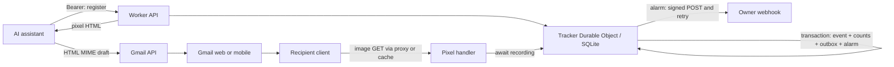

# Architecture

- `src/index.ts`: routing, authentication, pixel response and owner setup. Tokens never enter pixel URLs. Public callers cannot choose a tenant or receiver.
- `src/lib.ts`: validation, signatures, owner cookies, evidence flags and relative times.
- `src/store.ts`: SQLite storage, atomic counts, cursor histories, transactional outbox and alarm delivery.
- `src/types.ts` / `src/storage-types.ts`: public data contracts and SQLite row shapes. `src/env.ts` types the Worker bindings and Durable Object RPC.
- `cli/`: draft-only raw Gmail integration, Google OAuth SDK + loopback PKCE/state, OS credential storage, private operation journals, saved-HTML verification and manual arming. Google credentials stay outside the Worker.
- `examples/`: low-level MIME integration, history viewer and receiver verification. The short-lived-token example remains compatible.

One server-selected object, `self-hosted:v1`, keeps messages discoverable without an eventually consistent index and serializes the first-notification decision. It targets personal email volume. Schema creation is idempotent; future schema changes require migrations. Numeric cursors and UUID event IDs avoid timestamp collisions.

Each image GET awaits a transaction containing its event, counts, optional outbox job and alarm. Outbound HTTP happens afterward. The alarm persists an attempt and recovery deadline before external I/O; payloads/destinations stay stable across retries. Completed jobs retain diagnostics until deletion. A crash after acceptance can cause a duplicate. There is no permanent-failure redrive or automatic retention.

The server cannot observe actual reads or Gmail sends. Proxy cache hits never arrive. Storage failures lose events while still returning an image. HEAD does not record; unknown IDs do not allocate storage. Public responses do not reveal whether a message is registered.

## Future hosted edition

The supported self-hosted Gmail setup is bring-your-own Google Cloud project and Desktop OAuth client; a compatible existing connector is an optional shortcut. The local flow uses Gmail API and OAuth only, with no GCP compute, Pub/Sub or billing setup. Follow the [agent Gmail setup guide](agent-setup-gmail.md) for current costs and OAuth lifecycle details. A managed edition could remove project/client setup for end users, but hosting alone does not implement automatic Gmail compose insertion or Sent detection. Neither feature exists in the current release.

For already tracked drafts, an automatic Sent detector could use Gmail mailbox history through polling or [watch + Pub/Sub](https://developers.google.com/workspace/gmail/api/guides/push). It would require additional read/metadata authorization, a continuously running watcher, draft-to-sent correlation, synchronization recovery, and a policy for fetches arriving before a delayed send notification. `gmail.compose` alone cannot call `watch`. This would remove the human send report, but would not insert pixels into ordinary Gmail-composed mail or eliminate proxy caching.

For zero per-message interaction in native Gmail, a Workspace-specific option is an [outbound gateway](https://knowledge.workspace.google.com/admin/gmail/advanced/add-an-outbound-gateway-for-outgoing-email): after Send, an SMTP service could register the message, insert the pixel, arm tracking, and relay to the recipient. This is a proposed architecture, not a verified redpixels implementation. It requires Workspace administrator routing, an SMTP relay with queues/retries, access restrictions and TLS, plus SPF/DKIM handling after modifying the message. The documented route is for Workspace organizations, not a personal `@gmail.com` account. The current Worker cannot serve as the public SMTP endpoint: [Workers TCP support](https://developers.cloudflare.com/workers/runtime-apis/tcp-sockets/) does not accept public inbound TCP. This optional delivery system is outside the shipped one-Worker setup.

The local CLI uses a Desktop OAuth client and keeps Google refresh tokens in the owner's OS credential store. A future hosted Gmail integration needs its own Web OAuth client with a server-side HTTPS callback and encrypted, tenant-scoped token storage. Use a separate production Google Cloud project from personal/internal or development clients. Hosted users would authorize the operator's application; they would not each configure a Desktop client. Keep MIME generation and saved-draft verification reusable, while replacing the OAuth adapter, credential store and operation journal. A public hosted integration using `gmail.compose` needs Google's restricted-scope verification and, where applicable, a security assessment; adding a Web client alone does not satisfy those requirements.

Replace authentication with verified key lookup returning a server-controlled principal/tenant, then derive object names from that tenant. Pixel routes will need an opaque tenant locator and explicit isolation tests. Never trust a caller-supplied tenant ID. The current release has one owner only.

Registration, observed requests, eligible requests, enqueued notifications and acknowledged delivery have separate records/counters. These can feed later metering after defining billing events and idempotent usage export. `eligible_open_count` is not human readership; `webhook_count` is not billing usage. Add quotas, abuse controls, retention/export policies, per-tenant secrets and schema migrations with hosted requirements. No billing or hosted control plane is included.
