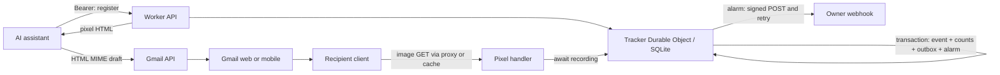

# Architecture

- `src/index.ts`: routing, authentication, pixel response and owner setup. Tokens never enter pixel URLs. Public callers cannot choose a tenant or receiver.
- `src/lib.ts`: validation, signatures, owner cookies, evidence flags and relative times.
- `src/store.ts`: SQLite storage, atomic counts, cursor histories, transactional outbox and alarm delivery.
- `src/types.ts` / `src/storage-types.ts`: public data contracts and SQLite row shapes. `src/env.ts` types the Worker bindings and Durable Object RPC.
- `examples/`: assistant-side Gmail integration, history viewer and receiver verification. Gmail access stays outside the Worker.

One server-selected object, `self-hosted:v1`, keeps messages discoverable without an eventually consistent index and serializes the first-notification decision. It targets personal email volume. Schema creation is idempotent; future schema changes require migrations. Numeric cursors and UUID event IDs avoid timestamp collisions.

Each image GET awaits a transaction containing its event, counts, optional outbox job and alarm. Outbound HTTP happens afterward. The alarm persists an attempt and recovery deadline before external I/O; payloads/destinations stay stable across retries. Completed jobs retain diagnostics until deletion. A crash after acceptance can cause a duplicate. There is no permanent-failure redrive or automatic retention.

The server cannot observe actual reads or Gmail sends. Proxy cache hits never arrive. Storage failures lose events while still returning an image. HEAD does not record; unknown IDs do not allocate storage. Public responses do not reveal whether a message is registered.

## Future hosted edition

Replace authentication with verified key lookup returning a server-controlled principal/tenant, then derive object names from that tenant. Pixel routes will need an opaque tenant locator and explicit isolation tests. Never trust a caller-supplied tenant ID. The current release has one owner only.

Registration, observed requests, eligible requests, enqueued notifications and acknowledged delivery have separate records/counters. These can feed later metering after defining billing events and idempotent usage export. `eligible_open_count` is not human readership; `webhook_count` is not billing usage. Add quotas, abuse controls, retention/export policies, per-tenant secrets and schema migrations with hosted requirements. No billing or hosted control plane is included.
